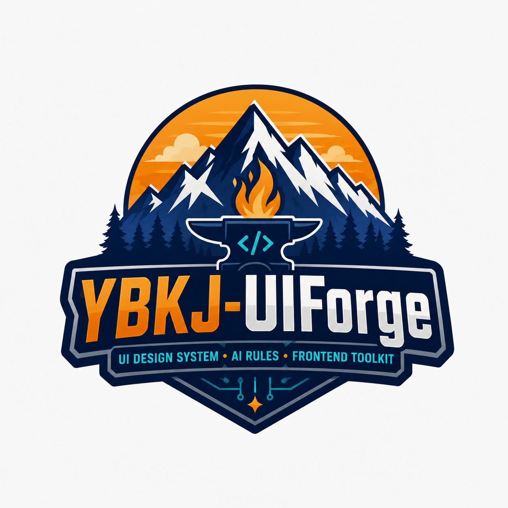

  

<h1 align="center">YBKJ-UIForge</h1>

<a href="README.md">简体中文</a> · <strong>English</strong>

Industrial UI design principles and reusable engineering rules

## Overview

UIForge serves YBKJ intelligent maintenance products and selected personal projects. It aims to improve generic AI-generated interfaces through shared design principles, design tokens, component patterns, AGENTS.md / project rules, Codex and Trae prompts, smoke checklists, and migration guidance.

The first source pilot identified by the existing project is YBKJ-LinkScope-V2. The current repository is a Markdown design and engineering rule foundation, not a published component package or a verified production UI framework.

## Documentation

- [Project overview (Chinese)](docs/00_overview/YBKJ_UIForge_定位说明.md)
- [Industrial maintenance UI principles (Chinese)](docs/01_principles/工业维保UI设计原则.md)
- [Avoiding generic AI templates (Chinese)](docs/01_principles/去AI模板化设计原则.md)
- [Common engineering rules](docs/04_agents/AGENTS.common.md)
- [Frontend rules](docs/04_agents/AGENTS.frontend.md)
- [Safety rules](docs/04_agents/AGENTS.security.md)
- [AI execution prompts](docs/05_codex_prompts/README.md)
- [Porting guidance](docs/07_porting_guides/README.md)
- [UI smoke checklist](docs/08_smoke_checklists/ui_smoke_checklist.md)

## Candidate applications

YBKJ: NexOps, RefNova, ZWCloudCode, GeoLink, LinkScope, CamVision, NotiVision / NotiDetect, and the YBKJ website.

Personal projects: aileme, UmbTerra, RiftWorks and future selected products. These are candidate adaptation targets, not claims of completed adoption.

## Principles

- Rules first, then components and documentation.
- Pilot, abstract, then migrate.
- Solve actual project problems rather than building a universal toolkit prematurely.
- UI flexibility must not weaken industrial safety boundaries.
- Preserve mock labeling, redaction, read-only boundaries, evidence provenance and separate simulated, VM, real-device and field verification levels.

## Engineering identity and rights

**SNTL Lab** is the selected engineering identity for this governance draft. Existing project attribution and contribution records remain unchanged. It does not establish legal ownership.

[Copyright and reuse boundary](COPYRIGHT.md) · [Security policy](SECURITY.md)

Both documents are governance review drafts; no new public license or security certification is asserted. Third-party materials retain their original terms.

The Chinese README is the editorial reference. Keep both language versions aligned; linked technical documents retain their original language.
