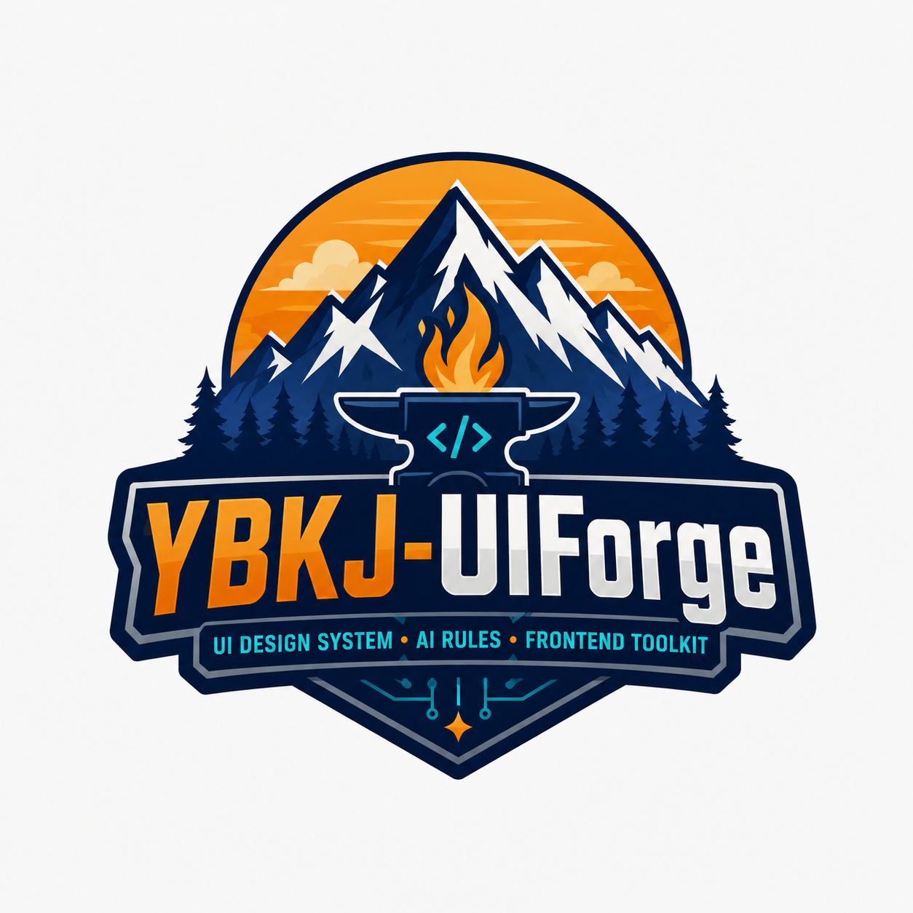

  

<h1 align="center">YBKJ-UIForge</h1>

<strong>简体中文</strong> · <a href="README.en.md">English</a>

工业 UI 设计原则与可复用研发规则库

[版权与复用边界（治理审阅稿）](COPYRIGHT.md) · [安全政策（治理审阅稿）](SECURITY.md)

## 项目定位

YBKJ-UIForge 是面向友邦科技智慧维保体系与个人项目的通用 UI 锻造库。

它用于沉淀：

- 去 AI 模板化的 UI 设计原则
- 工业维保风格 Design Tokens
- 可复用组件模式
- AGENTS.md / Project Rules 模板
- Codex / Trae 执行提示词
- Smoke Checklist
- 项目迁移指南
- 智慧维保项目与个人项目的 UI 优化经验

## 第一阶段目标

第一阶段以 YBKJ-LinkScope-V2 为来源试点，沉淀可复用的规则、设计 tokens、基础组件和迁移方法。当前实际仓库以 Markdown 设计与研发规则为主，不代表已发布可安装组件包或生产 UI 框架。

## 候选适用项目

以下为候选适配范围，不代表已完成迁移或获得第三方素材授权。

### 友邦科技智慧维保项目

- NexOps｜智维中枢
- RefNova｜智维元核
- ZWCloudCode｜智维云码
- GeoLink｜智维云图
- LinkScope｜链境
- CamVision｜溯影
- NotiVision / NotiDetect
- ybkj-ai.xyz

### 个人项目

- AI了么
- UmbTerra｜脚下宇宙
- RiftWorks｜破壁工坊
- 其他未来个人产品

## 核心原则

- 先规则，后组件，再文档
- 先试点，后抽象，再迁移
- 不追求通用大而全，优先解决真实项目问题
- UI 模板可以选择，业务边界不能放松
- 所有工业项目坚持 Mock、脱敏、只读、证据链和验证状态分级

## 文档导航

- [项目定位](docs/00_overview/YBKJ_UIForge_定位说明.md)
- [工业维保 UI 设计原则](docs/01_principles/工业维保UI设计原则.md)
- [去 AI 模板化设计原则](docs/01_principles/去AI模板化设计原则.md)
- [通用研发规则](docs/04_agents/AGENTS.common.md)
- [前端规则](docs/04_agents/AGENTS.frontend.md)
- [安全边界](docs/04_agents/AGENTS.security.md)
- [AI 执行提示词](docs/05_codex_prompts/README.md)
- [迁移指南](docs/07_porting_guides/README.md)
- [UI 验收清单](docs/08_smoke_checklists/ui_smoke_checklist.md)

## 研发身份及权利

**SNTL Lab** 为本次治理选定的研发身份，不改变原有归属、贡献记录或法律权属。

版权及安全政策均为治理审阅稿，不授予新增公开许可，不宣称安全认证。第三方材料保留原许可。

中文 README 为编辑基准，中英文同步维护，详细技术文档保留原语言。

公开可见不等于开源许可；采用规则、图标、组件或代码片段前须核验权利和目标项目实际验证状态。

[上一版完整主页（固定提交）](https://github.com/usydin/YBKJ-UIForge/blob/45a8b447cb2162cfb43088922705d87c3a6ac6ae/README.md)
